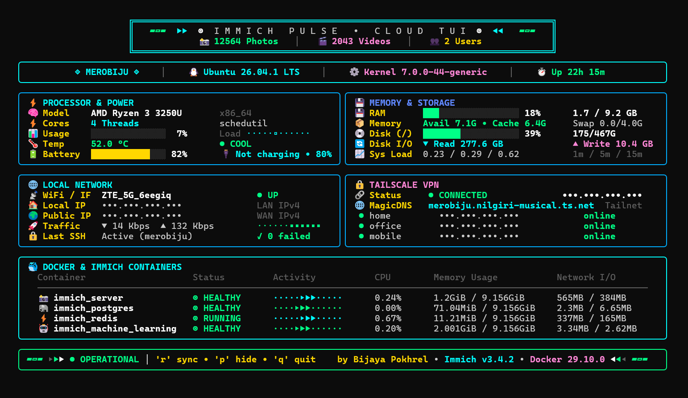

# ⚡ ImmichPulse — Ultra-Light Terminal Dashboard (TUI) for Immich


**ImmichPulse** is a blazing-fast, ~4MB single-binary Terminal UI (TUI) dashboard built in **Go (Bubble Tea + Lipgloss)** designed for self-hosted **Immich** servers.



## ✨ Features
- **Live Immich Library Stats:** Real-time count of **Photos, Videos, and Active Users** directly from your Immich PostgreSQL container (no API key setup needed).
- **Container Health & Metrics:** Live CPU, Memory, Network I/O, and health status for `immich_server`, `immich_postgres`, `immich_redis`, and `immich_machine_learning`.
- **Zero-Trust & Network Monitor:** Displays Tailscale VPN status, MagicDNS, peer nodes, local/public IPs, live traffic sparklines, and SSH failed login attempts.
- **Hardware & Laptop Server Ready:** Monitors CPU thermals, load sparklines, RAM/Swap, Disk I/O, and battery charge thresholds.
- **Ultra-Lightweight:** Compiled single binary (~3.9 MB) using <12MB RAM and near-zero CPU.

## 🚀 Quick Install
```bash
git clone https://github.com/merobiju/immich-pulse.git
cd immich-pulse
./install.sh
immich-pulse
```

## ⌨️ Keybindings
- `r` — Force refresh system & Docker metrics
- `q` or `Ctrl+C` — Exit cleanly

## 👨‍💻 Author
Built with ❤️ in Nepal by **Bijaya Pokhrel**.
